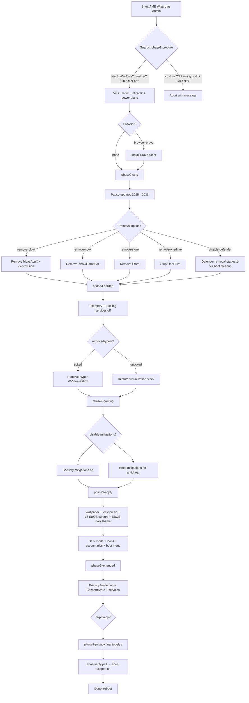

# EBOS [build 20261008.fb75f1]

Copyright (c) EBOS. Licensed under the PolyForm Noncommercial License 1.0.0 — see `LICENSE.txt`.

EBOS fully optimizes stock Windows for better responsiveness, max performance and zero tracking. This release is geared towards competitive gamers. Apply with AME Wizard in ~15 minutes.

## Requirements

- Stock Windows 10 22H2 (19044/19045) or Windows 11 23H2/24H2/25H2/26H2 (22631/26100/26200/26300)
- No pending updates, no third-party antivirus, BitLocker off, plugged in, internet connected (VC++ redist + optional Brave download)
- Internet is required unless the **Offline Mode** option is ticked and the bundled installers are present (see [Offline mode](#offline-mode))

Before you start, run `Executables\preflight-check.ps1` on the target PC. It is read-only, changes nothing, and writes `ebos-preflight.txt` to the Desktop: supported build, signs of an already-modified Windows, and the services/AppX packages this playbook is about to touch.

## Package layout

```
EBOS-11H2-release-r11/
├── playbook.conf            # wizard UI, options, supported builds
├── playbook.png             # wizard banner
├── BUILD-INFO.txt           # build id + applied steps
├── LICENSE.txt              # Copyright (c) EBOS + PolyForm terms
├── README.md                # this file
├── Configuration/
│   ├── main.yml             # Admin: phase1 → phase8
│   └── Tasks/
│       ├── phase1-prepare.yml
│       ├── phase2-strip.yml
│       ├── phase3-harden.yml
│       ├── phase4-gaming.yml
│       ├── phase5-apply.yml
│       ├── phase6-extended.yml
│       ├── phase7-privacy.yml
│       ├── phase7b-windhawk-styler.yml   # Admin; gated on windhawk-styler
│       └── phase8-user-hive.yml          # re-applies HKCU settings; runs verify
├── Executables/             # scripts, theme, icons, images, dxredist, cursors/
│   ├── ebos-dark.theme      # EBOS Dark (#3778B5 / #14263F)
│   ├── apply-ebos-theme.ps1 # accent + dark mode + No Sounds + CurrentTheme (.theme alone does nothing)
│   ├── ebos-verify.ps1      # post-apply check → %WINDIR%\EBOS\ebos-skipped.txt
│   ├── restore-personalization.ps1  # logon guard (cursors + wallpaper)
│   ├── configure-windhawk-styler.ps1 # taskbar + explorer transparency (option)
│   ├── build-windhawk-cache.ps1      # builds the offline bundle (dev machine only)
│   ├── test-ebos-bundles.ps1         # preflight: are the bundled assets complete?
│   ├── disable-windhawk-styler.ps1   # emergency rollback (Safe Mode safe)
│   ├── uninstall-windhawk.ps1        # full Windhawk removal (manual)
│   ├── preflight-check.ps1           # run BEFORE AME - read-only report on the Desktop
│   ├── apply-hkcu-fanout.ps1         # GENERATED - per-user hive repair pass
│   ├── BUNDLES.md                    # what goes in this folder for an offline image
│   ├── cursors/             # 17x ebos-*.ani
│   ├── dxredist/            # DirectX runtime (DXSETUP.exe /silent)
│   ├── wallpaper.png / lockscreen.png / profile.png
│   ├── ebos.ico / discord.ico (real ICO)
│   ├── start-menu.ps1                # NOT INVOKED - superseded by the phase2 Start block
│   ├── taskbar-pins.ps1              # NOT INVOKED - blob hardcodes C:\Users\user
│   └── (vc_redist / BraveSetup / windhawk-cli installer / windhawk-cache - bundled, not committed)
├── Images/
│   └── brave.png            # browser option icon
└── tools/
    ├── build-hkcu-fanout.py # regenerates apply-hkcu-fanout.ps1 from the YAML
    ├── check-ps-syntax.py   # brace/quote balance for every PS block in the playbook
    └── build-playbook.py    # validates the playbook and packs it into an .apbx
```

## Install flowchart



## Options (playbook.conf)

| Option | Effect |
|---|---|
| `browser-brave` | Install Brave silently |
| `remove-bloat` | Remove bloatware AppX + provisioned |
| `remove-xbox` | Remove Xbox + GameBar |
| `remove-store` | Remove Microsoft Store |
| `remove-edge` | Remove Edge |
| `remove-ai` | Remove Copilot/Recall |
| `remove-onedrive` | Strip OneDrive + scheduled tasks |
| `remove-hyperv` | Remove Hyper-V/Virtualization (breaks WSL/VMs/emulators) |
| `disable-defender` | Remove Defender + SmartScreen (reboot required) |
| `disable-mitigations` | VBS/HVCI off, vulnerable-driver blocklist off |
| `disable-power-saving` | Ultimate Performance plan, hibernate off |
| `disable-auto-driver-updates` | Exclude drivers from Windows Update |
| `disable-printing` | Printing stack off |
| `disable-webview2` | Remove WebView2 |
| `disable-wifi` | Wi-Fi stack off |
| `disable-bluetooth` | Bluetooth stack off |
| `disable-location` | Location + Maps off |
| `disable-storage-sense` | Storage Sense off |
| `remove-accessibility` | Accessibility features removed |
| `fs-privacy` | Extra privacy hardening (phase7) |
| `fs-wallpaper` | EBOS wallpaper + lockscreen + account picture |
| `fs-darkmode` | Dark mode + EBOS accent + No Sounds + EBOS Dark theme |
| `fs-noanimations` | Animation effects off |
| `fs-notransparency` | Transparency effects off |
| `fs-w10-context` | Windows 10 context menu |
| `fs-w10-taskbar` | Windows 10 taskbar |
| `fs-w10-tbleft` | Left taskbar alignment |
| `fs-small-icons` | Small desktop icons |
| `windhawk-styler` | Windhawk taskbar + File Explorer transparency (Win11, phase7b) |
| `offline-mode` | Phase 1 uses bundled installers, never downloads |

## Offline mode

Ticking **Offline Mode** makes the whole apply work with no network. Phase 1 writes
`%WINDIR%\EBOS\offline-mode.flag`; every later download site reads that flag rather than its
own logic, so one checkbox governs the engine installer, the mod cache and the two Phase 1
downloads.

Bundle these in `Executables/` — see [Executables/BUNDLES.md](Executables/BUNDLES.md):

| File | Needed for | If missing while offline |
|---|---|---|
| `vc_redist.x64.exe` | Visual C++ runtime | skipped, logged to `ebos-skipped.txt` |
| `BraveSetup.exe` | `browser-brave` | skipped, logged — can leave you with no browser |
| `windhawk-cli-<ver>-installer.exe` | `windhawk-styler` | step exits 3 |
| `windhawk-cache/` | `windhawk-styler` | step exits 3 |

Build and verify on a connected Windows 11 machine:

```powershell
.\build-windhawk-cache.ps1 -OutDir D:\ebos-offline-bundle   # engine + mods + settings
.\test-ebos-bundles.ps1 -RequireOffline                      # exit 0 = air-gap ready
```

Then test the real thing with the network unplugged and Offline Mode ticked.

A local installer by itself is **not** enough: `whcli install <id>` pulls precompiled mods from
`mods.windhawk.cloud`. `windhawk-cache/` (made by `whcli export-cache`) is what removes that
dependency, and it carries each mod's settings too.

Offline Mode does not touch Phases 2–7; only the three download sites change.

## Silent / unattended contract

Every phase runs with no prompts, no dialogs and no `Read-Host`.

- **Failure reporting** is a non-zero exit code plus a line in `%WINDIR%\EBOS\failure.txt`.
  Phase 1's guard paths previously opened a `MessageBox`; they now write the reason and exit 1,
  so an unattended apply can never sit waiting for a click.
- **Elevation** is inherited from the wizard. `configure-windhawk-styler.ps1` refuses with exit
  2 rather than triggering a UAC prompt.
- **Installer flags** are chosen per installer, not blanket-applied:

| Installer | Flags | Note |
|---|---|---|
| windhawk-cli | `--silent --no-system-tray [--auto-updates] [--add-defender-exclusion]` | `--auto-updates` omitted when offline |
| VC++ redist | `/install /quiet /norestart /log <file>` | Burn bundle |
| Brave | `/silent /install` | stub installer |
| DirectX (`DXSETUP`) | `/silent` | ships in `dxredist/` |

  `/VERYSILENT` and `/SUPPRESSMSGBOXES` are **Inno Setup** switches. None of the installers
  here are Inno; passing them can make an installer show a usage dialog, which is the one
  thing guaranteed to block an unattended run. If you swap in an Inno-based installer, add
  them at that point.

## Windhawk transparency

`windhawk-styler` (default unticked) installs the headless windhawk-cli engine and applies
transparent taskbar and File Explorer styling via the Windows 11 Taskbar Styler and File
Explorer Styler mods.

- Windows 11 only — exits 0 on build < 22000, since File Explorer Styler has nothing to hook
  on Windows 10.
- Uses the bundled installer whenever present; only falls through to GitHub when Offline Mode
  is clear and no local copy exists.
- Coexists with the Phase 7 Windhawk GUI: windhawk-cli detects it and defers, managing the
  GUI's mod store instead of running a second engine.

> **Open decision.** Phase 7 bundles and installs the Windhawk GUI 1.7.3; Phase 7b then
> installs windhawk-cli, which detects the GUI and defers to it. That is two Windhawk engines
> on one image for one feature. It works — the CLI becomes a manager for the GUI's mods — but
> if you only want the transparency styling, dropping the Phase 7 GUI leaves a single engine
> and less to go wrong. Say which model you want before this ships; the current wiring assumes
> both, because both were already in the package.
- Restarts `explorer.exe` and waits for the shell to return (`-NoRestartExplorer` opts out).
- Engine installer is signature-checked; a non-Valid Authenticode signature aborts the step.
- Log: `%WINDIR%\EBOS\windhawk-styler.log`; profile snapshot:
  `windhawk-styler-profile.json`.

## If the shell breaks

File Explorer Styler carries a known open report — [styling-guide#79](https://github.com/ramensoftware/windows-11-file-explorer-styling-guide/issues/79) —
against build **26200.8737 (25H2)**, which is one of the builds EBOS supports. The maintainer
says 25H2 is supported and has questioned the diagnosis, so this is an unresolved report, not a
confirmed defect. It is handled defensively rather than by blocking the build:

1. **Automatic fail-safe.** After applying, the script restarts `explorer.exe` and waits for it
   to return. If it does not, the File Explorer mod is disabled, the engine restarted, the
   shell retried once, and the step exits 1. Taskbar styling is kept. If the CLI itself is
   unresponsive, the `WindhawkCLI` service is stopped and disabled. A machine with no
   transparency beats a machine with no desktop.
2. **Manual escape hatch**, runnable from Safe Mode, RDP or any elevated prompt:

```powershell
# disable the explorer mod only (taskbar styling stays)
.\disable-windhawk-styler.ps1

# disable everything, stop the service, restart the shell
.\disable-windhawk-styler.ps1 -All -StopService

# remove the engine entirely
.\disable-windhawk-styler.ps1 -All -StopService -UninstallEngine
```

Log: `%WINDIR%\EBOS\windhawk-styler.log`, tagged `[rollback]` for these runs.

## Integrity pinning

Both Windhawk installers are verified by **signature and SHA-256** before they execute. The
pin tables live in `configure-windhawk-styler.ps1`, `test-ebos-bundles.ps1` and
`build-windhawk-cache.ps1`.

| Asset | Version | SHA-256 | Verified here |
|---|---|---|---|
| `windhawk_setup.exe` | 1.7.3 | `5116cc17…23813c8f` | yes — matches the bundled copy |
| `windhawk-cli-1.1.0-installer.exe` | 1.1.0 | `63962b29…f7a238ab` | from release metadata, not the binary |

A mismatch is a hard failure. An unpinned build is allowed but logged as `UNPINNED BUILD` so
the next person can pin it instead of trusting it. Add a row to each table when adopting a new
release.

The engine download is a 302 to `objects.githubusercontent.com`, so an egress allowlist needs
**both** hosts, not just `github.com`. The offline path touches neither.

## Per-user settings

The playbook runs as TrustedInstaller, where `HKCU` is **SYSTEM's** hive - not the user who
logs in afterwards. A plain `!registryValue` with an `HKCU` path therefore writes somewhere no
user reads. The repo already knew this: `ebos-verify.ps1` maps `HKCU` to real user hives with
the comment "HKCU inside a TrustedInstaller process is SYSTEM's hive", and two blocks in
phases 2 and 6 were hand-patched to fan out over `HKEY_USERS`.

Phase 8 makes that systematic. It replays **all 256** `HKCU` actions against:

- every loaded `S-1-5-21-*` profile
- `AME_UserHive_Default`, when AME provides it
- `HKU\.DEFAULT`
- `C:\Users\Default\NTUSER.DAT`, mounted offline when it is not already loaded

Each entry keeps the option gate it was declared under, so unticked options stay skipped and
`!option` inversion matches `ebos-verify.ps1`.

The data is **generated**, not hand-maintained:

```bash
python3 tools/build-hkcu-fanout.py     # after touching any HKCU registryValue
python3 tools/check-ps-syntax.py       # before shipping: 245 PS blocks, must be 0 issues
python3 tools/build-playbook.py        # validate everything, then pack the .apbx
```

Verification moved from phase 7 to phase 8 so it inspects the final state - otherwise it
reports values that phases 7b and 8 repair after it runs.

Results land in `%WINDIR%\EBOS\hkcu-fanout.txt` (`applied=`, `skipped_gate=`, `failed=`,
plus the hive list).

## Building the .apbx

An `.apbx` is a 7-Zip archive with the playbook files at the **root** (`playbook.conf`
first, not nested inside a folder), AES-256 encrypted with encrypted headers and the
AME Wizard convention password `malte`. The password is not a secret - it stops browsers
and antivirus from scanning the bundled executables.

```bash
python3 tools/build-playbook.py                  # validate, then write release/EBOS-v<version>.apbx
python3 tools/build-playbook.py --dry-run        # validate only
python3 tools/build-playbook.py --require-bundles  # offline release: missing binaries become errors
```

The build refuses to ship an archive that would load but fail halfway through on a real
machine. Before packing it checks that:

| Check | Why |
|---|---|
| `playbook.conf` parses and has every required element | the wizard reads it first |
| `SupportedBuilds` equals the `$supported` gate in phase 1 | otherwise the wizard says "supported" and phase 1 says "no" |
| every YAML file parses; every `!task` target exists | a broken task file aborts the phase |
| no task file is unreferenced from `main.yml` | dead file that looks maintained |
| every `option:` is declared, every declared option is used | a typo'd name silently never runs |
| all PowerShell snippets balance | YAML cannot see inside a `command:` string |
| every file an action reaches for exists | a missing script is a silent no-op |
| image-backed options have their `Images/<name>.png` | otherwise the wizard shows a blank tile |
| nothing is zero bytes | truncated copy |

Bundled binaries are not committed, so their absence is a **warning** by default - an
online install still works. `--require-bundles` promotes them to errors, which is what
you want before publishing an offline release. See `Executables/BUNDLES.md`.

`release/` and `*.apbx` are gitignored; rebuild in about 30 seconds.

The archive is written by `py7zr` but read by AME Wizard's own 7-Zip, so the two have to
agree. Verified with p7zip 16.02: `7z t` reports *Everything is Ok* on all 228 entries,
`7z l` lists names only with the password, and extraction returns byte-identical files.

### Releasing

A release asset can only be uploaded to `uploads.github.com`, which is not reachable from
every build machine. `.github/workflows/` is outside what this repository's automation
token may write, so `tools/ci/release.yml` is parked there ready to copy:

```bash
mkdir -p .github/workflows && cp tools/ci/release.yml .github/workflows/release.yml
```

Once committed, every tag push builds the archive on a runner, checks it with real 7-Zip
and attaches it to the release - no local upload needed. The workflow refuses a tag that
does not equal `<Version>` in `playbook.conf`, because AME Wizard compares the two when
deciding whether an update is available.

Until then, after building locally:

```bash
gh release upload 11.2 release/EBOS-v11.2.apbx
```

## Verification

After apply, `ebos-verify.ps1` re-reads every declared registry value, key, service, task, AppX entry and file (theme content, 17 cursors, ICO headers). Anything that did not take is logged to `%WINDIR%\EBOS\ebos-skipped.txt`. Gated options that were unticked count as not-applicable, not failures.

## Notes

- Defender removal is destructive and needs the reboot notice; re-enable only via stock reinstall path.
- `disable-mitigations` + most anticheats don't mix — leave mitigations on for competitive games.
- Personalization guard runs at each logon and repairs only what Windows reset (26H2 regression).
